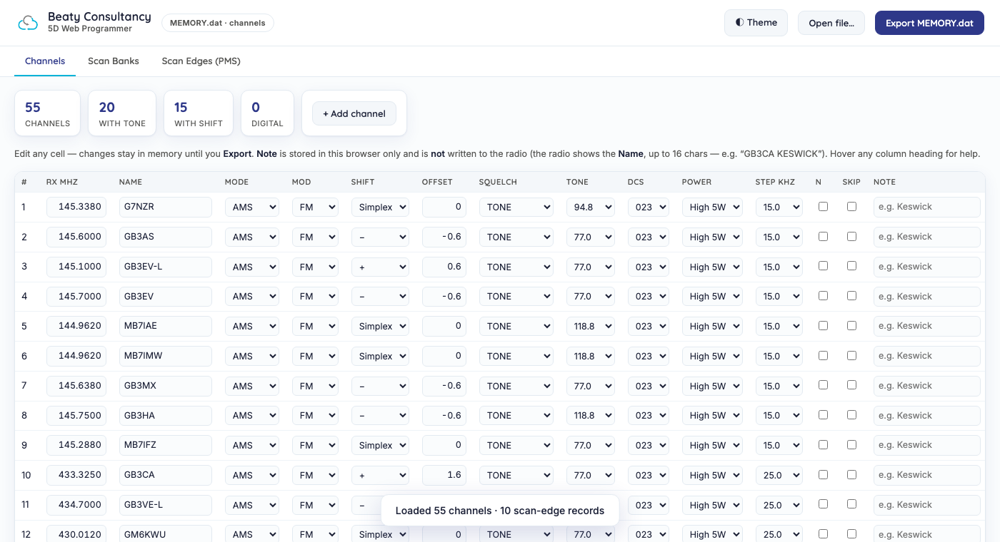
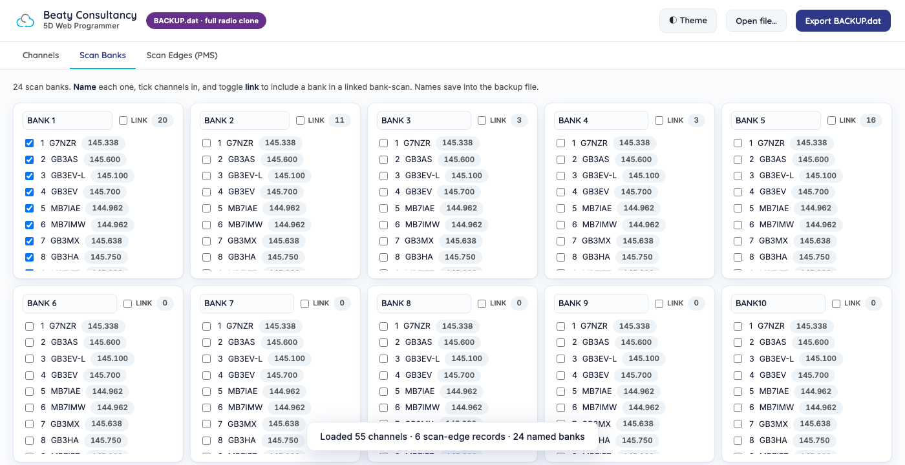

<div align="center">

# 5D Web Programmer

**A free, open-source, in-browser codeplug editor for the Yaesu FT-5DE / FT-5D.**

Read and write the SD-card `MEMORY.dat` directly — no Yaesu software, no drivers,
no cable, nothing leaves your device.

_by [Beaty Consultancy](https://beatyconsultancy.co.uk) — friendly, affordable cloud consultancy_

[](LICENSE)
&nbsp;·&nbsp; Runs entirely in your browser &nbsp;·&nbsp; Works offline

</div>



---

## What it is

The FT-5D stores its memory channels on the microSD card as a binary file at
`FT5D_MEMORY-CH/MEMORY.dat`. This tool decodes that file, lets you edit everything
in a clean table, and writes a valid file back — all client-side in a single HTML
page. No installation, no account, no upload. Your codeplug never leaves your computer.

It exists because the only official way to program these radios in bulk is Yaesu's
Windows-only **ADMS-14**, which needs the paid programming cable. This does the same
job from any browser, on any OS, for free.

## Features

- **Full channel editor** — frequency, name, mode (Analog / AMS / DN / VW), repeater
  shift including **odd/non-standard splits**, CTCSS **tone**, **tone-squelch (TSQL)**,
  **DCS** codes, TX power, tuning step, narrow FM, and scan-skip.
- **24 scan banks** — group channels for bank scanning; a channel can live in several banks.
- **Full-backup mode** — open the radio's `BACKUP.dat` full clone and the app unlocks
  editable **bank names** and bank-link flags (more deep config to come). It auto-detects
  whether you opened a `MEMORY.dat` (channels) or a `BACKUP.dat` (full clone) and writes
  the correct file with the correct checksum.
- **Scan edges (PMS)** — edit the programmable-memory-scan range pairs (handy for scanning
  business / PMR / event band *ranges*, which the FT-5D sweeps via PMS rather than a bank).
- **Private notes** — jot a reminder against any channel (stored in your browser only).


- **Safe by construction** — the decoder/encoder is validated **byte-for-byte** against
  Yaesu ADMS-14's own output, and the checksum is recomputed on export.
- **Zero dependencies, one file** — `index.html` is entirely self-contained.

## Use it

1. Open **`index.html`** in any modern browser (or host it anywhere — it's a static file).
2. Take the microSD card out of the radio, put it in your computer, and **Open**
   `FT5D_MEMORY-CH/MEMORY.dat`.
3. Edit channels, banks and scan edges. Hover any column heading for help.
4. **Export MEMORY.dat**, copy it back to `FT5D_MEMORY-CH/` on the card (replacing the
   original), and on the radio: **MENU → SD CARD → 2 MEMORY CH → Read from SD**.

> ⚠️ **Always keep a backup of your card first.** This is community software, provided
> as-is with no warranty (see [Disclaimer](#disclaimer)).

## Theme

Ships in the Beaty Consultancy brand theme (light) by default; a dark theme is one
click away via the **Theme** button, and your choice is remembered.

## Command-line engine (optional)

The same validated encoder is available as a small, dependency-free Python library in
[`engine/`](engine/), for scripting or building codeplugs programmatically:

```python
from ft5d_codeplug import record, build

# one channel: GB3CA — 433.325 MHz, +1.6 MHz shift, 77.0 Hz access tone
rec = record(mhz=433.325, tag="GB3CA", mode="AMS",
             offset_mhz=1.6, tone_hz=77.0, sql="TONE", step_khz=25.0)

# build a full MEMORY.dat from a radio-exported template + a list of channels
out = build(base_bytes, channels=[...], pms=[...], banks={1: [1, 2, 3]})
```

See [`engine/example.py`](engine/example.py) for a runnable end-to-end example.

## How it works

The FT-5D `MEMORY.dat` layout was reverse-engineered and is documented in full at
[`docs/FT5D-FORMAT.md`](docs/FT5D-FORMAT.md) — file regions, the 32-byte channel
record, every value table, the scan-bank and PMS formats, and the checksum. The
encoder in this tool is derived from and validated against that specification, so
exported files are byte-identical to what the radio itself produces for the same
settings.

## Compatibility

Built for and tested with the **Yaesu FT-5DE** (UK/EU). The FT-5D memory format is the
same, so it should work on the FT-5DR too. It does **not** touch APRS, WIRES-X, DTMF or
the radio's menu settings — those live in the separate full-backup file, not `MEMORY.dat`.

## Disclaimer

Not affiliated with, endorsed by, or connected to Yaesu / Yaesu Musen Co., Ltd. "Yaesu",
"FT-5D" and "ADMS" are trademarks of their respective owners. This project reads and
writes an interoperable file format for the purpose of interoperability; it contains no
Yaesu software. Transmitting is your responsibility — only transmit where you are
licensed and permitted to do so. Provided under the MIT License with **no warranty**;
you are responsible for keeping backups of your data.

## Contributing

Issues and pull requests welcome. If you have an FT-5D and spot a setting that isn't
handled or doesn't round-trip, please open an issue with (a redacted) example.

## License

[MIT](LICENSE) © Beaty Consultancy
